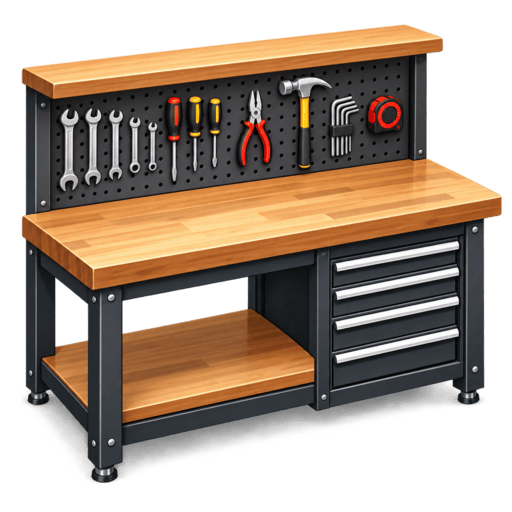

<div align="center">
  
  <h1>WorkBench</h1>
  <p><strong>Organização prática para serviços, materiais, ferramentas e equipes.</strong></p>
  <p>
    Aplicativo desktop para acompanhar a rotina de uma operação em um só lugar,
    com dados armazenados localmente.
  </p>
</div>

<p align="center">
  
  
  
  
</p>

## Sobre o projeto

O WorkBench é um aplicativo desktop desenvolvido para centralizar informações importantes da operação diária. Com ele, é possível planejar serviços, acompanhar materiais e ferramentas e manter os dados da equipe organizados, sem depender de uma conta ou de um serviço de banco de dados remoto.

O projeto usa **Electron**, **React** e **TypeScript**. Os registros são persistidos em um banco **SQLite** no computador onde o aplicativo é executado.

## Funcionalidades

| Módulo | O que você pode fazer |
| --- | --- |
| **Serviços** | Organizar a agenda semanal, cadastrar serviços e clientes, atribuir responsáveis, definir prioridade e configurar dias e horários de trabalho e o intervalo da grade. |
| **Estoque** | Cadastrar materiais com quantidade, unidade, valor e imagem; pesquisar itens, acompanhar o nível de estoque e visualizar o valor total em diferentes formatos. |
| **Ferramentas** | Registrar ferramentas, quantidade, valor, responsável, status e datas de manutenção ou descarte; consultar alertas para itens que precisam de atenção. |
| **Funcionários** | Manter cadastros com nome, cargo, contato, data de admissão, observações, foto e status; pesquisar e filtrar a equipe. |

O menu de alertas reúne avisos de manutenção vencida ou próxima, descarte e ferramentas que precisam de reparo ou troca. Clicar em um alerta leva diretamente ao cadastro correspondente.

## Primeiros passos

### Requisitos

- [Node.js](https://nodejs.org/) e npm
- Git, caso queira clonar o repositório

### Instalar e executar

```bash
git clone https://github.com/SamuelGuimaraesCosta/WorkBench.git
cd WorkBench
npm install
npm run dev
```

O comando `npm run dev` inicia o aplicativo em modo de desenvolvimento. Ao abrir pela primeira vez nesse modo, o WorkBench cria um banco local com dados de demonstração para facilitar a exploração dos módulos.

> **Atenção:** os dados de demonstração são inseridos apenas quando um banco novo é criado em desenvolvimento. Eles não são incluídos automaticamente em uma instalação de produção.

## Comandos disponíveis

| Comando | Descrição |
| --- | --- |
| `npm run dev` | Executa o aplicativo em modo de desenvolvimento. |
| `npm run build` | Verifica os tipos TypeScript e compila o aplicativo. |
| `npm run start` | Abre uma prévia da versão compilada. |
| `npm run lint` | Analisa o código com ESLint. |
| `npm run typecheck` | Verifica os tipos dos processos Node e web. |
| `npm run format` | Formata os arquivos com Prettier. |
| `npm run build:win` | Compila e empacota o aplicativo para Windows. |
| `npm run build:mac` | Compila e empacota o aplicativo para macOS. |
| `npm run build:linux` | Compila e empacota o aplicativo para Linux. |

Os instaladores são gerados pelo `electron-builder`. Para empacotar para um sistema operacional, execute o comando correspondente em um ambiente compatível com esse sistema.

## Dados e privacidade

O banco é criado como `workbench.db` na pasta de dados do usuário definida pelo Electron. As imagens importadas ficam na subpasta `images` dessa mesma localização. O caminho exato depende do sistema operacional.

Os dados do aplicativo ficam no computador e **não são sincronizados entre dispositivos**. O WorkBench não oferece uma função própria de backup: para preservar os registros, feche o aplicativo e copie o arquivo `workbench.db` e a pasta `images` para um local seguro. Ao restaurar, mantenha os dois na pasta de dados do usuário do aplicativo.

## Estrutura do projeto

```text
src/
├── main/       Processo principal do Electron, banco de dados, repositórios e IPC
├── preload/    Ponte controlada entre o processo principal e a interface
├── renderer/   Interface React, páginas e componentes
└── shared/     Tipos e contratos compartilhados entre os processos
```

- **Banco de dados:** esquema SQLite e migrações em `src/main/db`.
- **Acesso aos dados:** repositórios e manipuladores IPC em `src/main/repositories` e `src/main/ipc`.
- **Interface:** páginas dos módulos em `src/renderer/src/pages`.
- **Empacotamento:** configurações do Electron Vite e Electron Builder na raiz do projeto.

## Tecnologias

- [Electron](https://www.electronjs.org/) e [electron-vite](https://electron-vite.org/) para a aplicação desktop.
- [React](https://react.dev/) e [React Router](https://reactrouter.com/) para a interface.
- [TypeScript](https://www.typescriptlang.org/) para tipagem estática.
- [SQLite](https://www.sqlite.org/) com `better-sqlite3` e [Drizzle ORM](https://orm.drizzle.team/) para persistência local.
- [ESLint](https://eslint.org/) e [Prettier](https://prettier.io/) para qualidade e formatação do código.

## Contribuindo

Contribuições são bem-vindas. Para propor uma mudança:

1. Crie uma branch a partir da versão mais recente do projeto.
2. Faça a alteração e inclua testes quando aplicável.
3. Execute `npm run lint` e `npm run typecheck`.
4. Abra um pull request descrevendo o problema e a solução.
